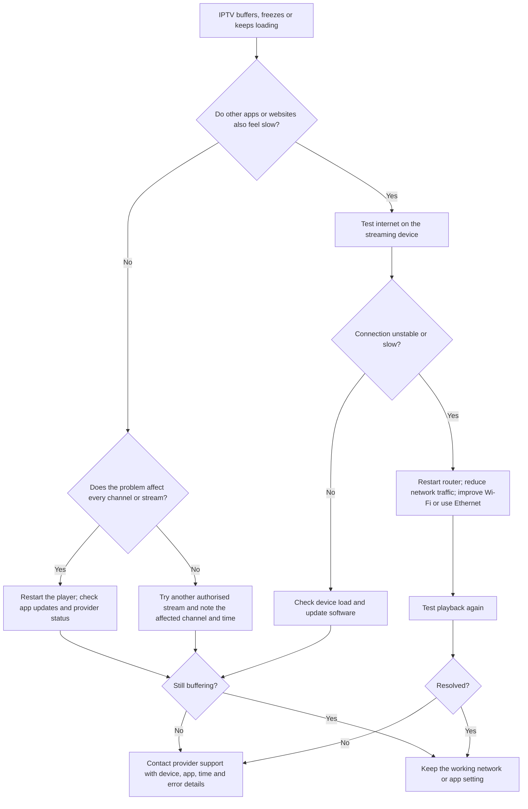

# IPTV Buffering Fixes: How to Stop IPTV from Buffering, Freezing and Lagging

IPTV buffering usually means your player cannot receive or decode the next part of a stream quickly enough. The cause may be local Wi-Fi interference, an unstable internet connection, congestion on your home network, an overloaded device, an app problem or an issue with the streaming service. The most useful first step is to isolate where the problem occurs instead of changing several settings at once.

This guide walks through a practical diagnosis, compares Wi-Fi with Ethernet, explains the most common causes and gives step-by-step fixes for Smart TVs, Fire TV devices, Android TV boxes, phones and computers. Use these checks only with services and streams you are authorised to access.

## Quick IPTV buffering troubleshooting flowchart

Follow the path from the top. Change one thing at a time, then replay the same channel or programme for long enough to see whether the problem returns.

**How to read the flowchart:** if several unrelated apps are slow, start with your internet connection or home network. If everything else streams normally but one IPTV service keeps buffering, investigate the player and service before changing router settings.

## Common causes of IPTV buffering

| Possible cause | Typical clue | What to check first |
| --- | --- | --- |
| Weak Wi-Fi signal | Buffering gets worse in rooms farther from the router | Signal strength, distance, walls and interference |
| Network congestion | Playback worsens when other people download, game or stream | Pause large downloads and retest |
| Unstable broadband | Speed or latency varies between tests | Run more than one test, ideally on the streaming device |
| Router or modem issue | Several devices disconnect or slow down | Restart networking equipment and check its status |
| Device performance | Menus lag, the player freezes or the device feels hot | Close unused apps, restart and check available storage |
| App issue | One player has trouble while another supported app works | Update the app or check its official help instructions |
| Provider or stream issue | Other internet services work, but a particular stream does not | Check service notices and contact the provider |
| Outdated device software | Problems began after an app or operating-system change | Install updates from official sources |

A speed-test result is only one clue. Consistency, packet loss, latency, Wi-Fi quality, device performance and the streaming service's own capacity can all affect playback. There is no single download-speed number that guarantees smooth streaming on every service, resolution and household network.

## Wi-Fi vs Ethernet for IPTV

A wired Ethernet connection is usually the best diagnostic test when Wi-Fi may be unstable. It avoids many wireless variables, but it cannot fix a provider-side outage, a slow broadband connection or an underpowered device.

| Factor | Wi-Fi | Ethernet |
| --- | --- | --- |
| Stability | Can vary with distance, walls and interference | Usually more consistent |
| Installation | Convenient; no cable run required | Requires a network cable and a port or suitable adapter |
| Speed consistency | Depends on signal quality, band and congestion | Typically less affected by nearby wireless activity |
| Device placement | Flexible within wireless coverage | Limited by cable reach |
| Best use | Convenient everyday connection with a strong signal | Troubleshooting and fixed TV or streaming-box setups |

**Practical recommendation:** if your TV or streaming box has an Ethernet port, connect it directly to the router and test the same stream again. If buffering stops, the Wi-Fi connection is likely part of the problem. If it continues, move on to device, app and service checks. If your device has no Ethernet port, use only a compatible, reputable adapter supported by its manufacturer.

## Step-by-step fixes for IPTV buffering

### 1. Test the connection on the streaming device

1. Open a trusted speed-test service or network diagnostic app on the TV, streaming device or a nearby device connected to the same network.
2. Run the test more than once, rather than relying on a single result.
3. Compare results at different times, especially when buffering is most noticeable.
4. If possible, compare the device's Wi-Fi result with a wired Ethernet test.
5. Look for unstable results, interruptions or high latency as well as download speed.

A phone next to the router may show a better result than a TV behind several walls. Test as close as possible to the device that actually plays the stream.

### 2. Improve the Wi-Fi signal

- Move the streaming device or router to a more open position, where practical.
- Reduce the number of walls and large obstacles between them.
- If your router offers both 2.4 GHz and 5 GHz Wi-Fi, test each from the device's normal viewing location. 5 GHz can offer more capacity at shorter range; 2.4 GHz may reach farther but can be more congested.
- Avoid placing the router inside a cabinet or directly beside sources of interference.
- If coverage is poor across the home, consider a properly configured access point or mesh system.

Do not assume that changing Wi-Fi bands always improves playback. Keep the option that gives the streaming device the most reliable connection.

### 3. Try Ethernet

Connect the device to the router with a known-working Ethernet cable, then replay the same stream. If the device is far from the router, a suitable wired network installation may be more reliable than a weak wireless signal. Avoid running cables where they create a trip hazard.

### 4. Reduce competing network traffic

Temporarily pause large downloads, game updates, cloud backups and other high-bandwidth activity. Ask other household members to pause heavy transfers during the test. If playback improves, investigate network congestion or router quality-of-service settings using the router manufacturer's documentation.

### 5. Restart the router and streaming device

1. Exit the streaming app.
2. Restart the TV, streaming stick or box using its normal restart option.
3. Restart the router or modem using the manufacturer's instructions.
4. Allow the network to reconnect fully.
5. Open the player and test again.

A restart can clear a temporary fault, but repeatedly restarting equipment is not a permanent fix if the underlying connection or service remains unstable.

### 6. Check the IPTV app and device

- Install app and operating-system updates from official stores or the device manufacturer.
- Close unused apps and restart the device if menus or playback are sluggish.
- Check available storage and remove only apps or files you recognise and no longer need.
- Review the app developer's official troubleshooting instructions.
- If you test another player, use only an app and sign-in method supported by your authorised provider.

Avoid unofficial APK download sites, modified player apps and unknown configuration files. They can expose your device or account to security risks.

### 7. Check whether the issue is service-side

If other websites and streaming apps work normally but one service or stream continues to buffer, the problem may be outside your home network. Check the provider's official service notices or support channel. Record the affected channel or programme, date and approximate time, device model, app version and any error message. Never publish passwords, activation codes, private playlist URLs or account credentials.

For current Kemo TV service information or support contact options, consult the [official Kemo TV website](https://kemoiptv.digital/). Check device compatibility, regional availability, terms and content-distribution authorisation directly with any provider; this independent guide does not verify a provider's claims or licensing.

## Device-specific checks

### Fire TV and Firestick

- Restart the Fire TV device from its settings.
- Check for Fire OS and app updates through the device's official settings and app store.
- Close apps you are not using and check available storage.
- Test closer to the router or with a compatible Ethernet adapter if supported by your model.
- If only one app has a problem, follow that app developer's official support steps before resetting the whole device.

### Smart TVs

- Restart the TV fully rather than only switching it to standby.
- Check the TV's network status and software updates.
- Compare Wi-Fi with Ethernet if the TV supports a wired connection.
- If the TV's built-in app is outdated or unsupported, check the TV manufacturer and app developer guidance before considering another supported device.

### Android TV and Google TV devices

- Restart the device and install system and app updates from official sources.
- Close unused apps and check storage.
- Test the network from the device itself.
- Use a compatible Ethernet connection when available.

## Quick checks: symptom to next action

| Symptom | Likely area to investigate | Next action |
| --- | --- | --- |
| Every app buffers | Home internet or router | Test the connection and compare Wi-Fi with Ethernet |
| Only one IPTV app buffers | App or service compatibility | Update the app and check its official support information |
| Only one channel buffers | Individual stream or provider-side issue | Note the channel and time; check with the provider |
| Buffering happens in the evening | Household or wider network congestion | Compare results at busy and quiet times |
| Picture freezes but menus remain responsive | Stream delivery or network interruption | Test another authorised stream and check connection stability |
| Device menus also lag | Device performance or storage | Restart, update and check free storage |

## Frequently asked questions

### Why does IPTV keep buffering even with fast internet?

A high headline download speed does not guarantee a stable connection. Wi-Fi interference, packet loss, latency spikes, household congestion, device limitations or problems at the streaming service can still interrupt playback. Test the connection on the streaming device and compare Wi-Fi with Ethernet.

### Is Ethernet better than Wi-Fi for IPTV?

Ethernet is generally more consistent because it avoids wireless interference and signal-strength changes. It is a useful troubleshooting test for TVs and streaming boxes that support a wired connection. It will not resolve a provider-side problem or an unstable broadband service.

### Why does IPTV buffer only on one channel?

If other channels and online apps work, the issue may be specific to that stream or the provider's delivery of it. Record the channel and time, test another authorised stream, and contact the provider if the issue continues.

### Should I use a VPN to stop IPTV buffering?

A VPN is not a universal buffering fix. It can sometimes change the network route, but it can also add latency or reduce throughput. First establish whether the problem is Wi-Fi, broadband, the device, the app or the service. Use a VPN only where lawful and permitted by the relevant service terms, and do not treat it as a way to bypass access restrictions.

## Related guides and tools

- [How to set up IPTV](iptv-setup-guide.md) — general setup and compatibility checks.
- [Choosing an IPTV app](iptv-apps-guide.md) — understand player apps and what to check before installing one.
- [IPTV device guide](iptv-devices-guide.md) — compare common device types.
- [M3U playlist format](m3u-playlist-format.md) — understand playlist structure and terminology.
- [M3U Playlist Inspector](https://drxalan32.github.io/m3u-playlist-inspector/) — inspect playlist text and metadata in your browser. It does not test remote stream availability or diagnose a provider's network.

## Responsible use and security

Use only services and streams you are legally entitled to access. Install apps from official sources, review permissions, and keep device software updated. Do not share private playlist URLs, passwords, activation details or account information in public posts or support forums.

*This guide is for general educational troubleshooting. Exact menu names and supported features vary by device, app, router, provider and region.*
