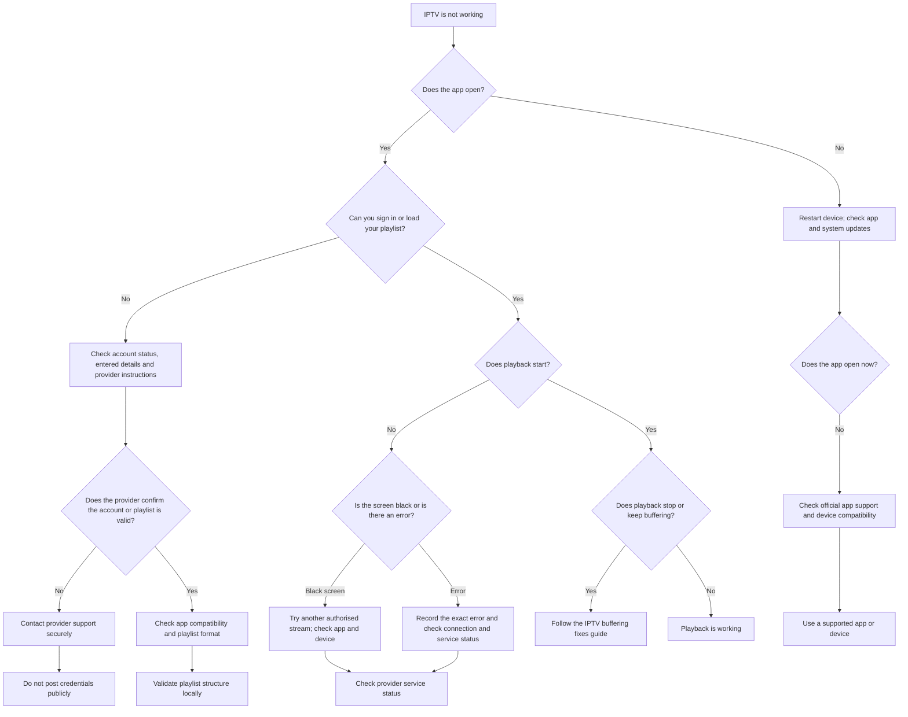

# IPTV Not Working? How to Fix IPTV Not Loading, Connection Errors and Playback Problems

When IPTV is not working, the first task is to identify what "not working" means. An app that will not open needs a different fix from a player that opens but shows a black screen, rejects a login or cannot load a playlist. This guide helps you diagnose the failure in a safe, logical order on Smart TVs, Fire TV devices, Android TV, phones and computers.

Follow the checks one at a time. Use only apps, playlists and streams you are authorised to access. Never share passwords, activation codes or private playlist URLs in public support posts.

## IPTV not working: quick troubleshooting flowchart

**Quick distinction:** if the app will not launch, start with the device and app. If the app opens but login or playlist loading fails, check account details and provider instructions. If playback starts and then repeatedly pauses, use the separate [IPTV buffering fixes guide](iptv-buffering-fixes.md).

## Identify the exact IPTV problem

| What you see | Where to start |
| --- | --- |
| App crashes or will not open | Device restart, app update and official compatibility information |
| Login rejected or authentication failed | Carefully recheck account details and account status with the provider |
| Playlist will not import | Check the file, URL handling, format and app instructions |
| "Unable to connect" or network error | Test the device's internet connection and check service status |
| Black screen with audio or no picture | Test another authorised stream and check app/device support |
| No channels or an empty list | Check playlist import, account status and provider-side availability |
| One channel does not play | Check whether the issue is limited to that stream |
| Playback starts then freezes | Diagnose buffering and network stability |

An error message is useful evidence. Write down its exact wording and when it appeared before changing settings.

## Step-by-step fixes

### 1. Check whether the device is online

1. Open a familiar website or another trusted streaming app on the same device.
2. If it cannot connect, check the device's Wi-Fi or Ethernet status.
3. Restart the device and reconnect to your normal network.
4. If possible, test another device on the same network.
5. If several devices are offline, check your router, modem and broadband provider for an outage.

A phone working on mobile data does not prove that the TV's Wi-Fi connection is working. Test on the device that is having the problem.

### 2. Restart the app and device

1. Exit the IPTV player completely.
2. Restart the TV, streaming stick, box or phone using its normal restart option.
3. Reopen the app and try again.
4. If the device remains unresponsive, follow the manufacturer's restart instructions.

A full factory reset should not be the first troubleshooting step. It can remove settings and account information without resolving a provider-side fault.

### 3. Check app and device compatibility

- Confirm the app is available for your exact device model and operating-system version.
- Install updates from the official app store or device manufacturer.
- Check the app developer's official help page for known issues.
- Confirm that your provider supports the app and its sign-in method.
- Avoid modified apps, unofficial APK download pages and unknown configuration profiles.

An app being available on one Smart TV model does not mean it is supported on every model or region.

### 4. Check login and account details

If the player opens but rejects your login:

1. Follow the provider's documented sign-in method.
2. Check for accidental spaces, typing mistakes or incorrect letter case where relevant.
3. Confirm that the subscription or account is active using the provider's official account or support channel.
4. Check whether the provider has changed its supported app or authentication instructions.
5. If the details appear correct, ask the provider to check the account status.

Do not repeatedly guess passwords, share account credentials with strangers or publish screenshots that expose usernames, passwords, portal addresses or activation codes.

### 5. Check an M3U playlist safely

If your player cannot load an M3U or M3U8 playlist file:

- Confirm that you selected the correct file and that the file is not empty.
- Check that the playlist is plain text and uses a supported format.
- Confirm that the file extension and encoding are accepted by the player.
- Look for malformed entries, missing line breaks or incomplete metadata.
- If the playlist is supplied by a provider, ask for a fresh copy or the correct import instructions through its official support channel.

A basic extended M3U playlist commonly starts with `#EXTM3U`. Entries may include an `#EXTINF` metadata line followed by a media URL. A playlist can be syntactically valid while its remote streams are unavailable, expired or inaccessible. A local format check cannot prove that a stream works or that content is authorised.

For more detail, read [M3U playlist format](m3u-playlist-format.md), [M3U vs M3U8](m3u-vs-m3u8.md) and [common M3U playlist errors](m3u-playlist-errors.md).

You can use the [M3U Playlist Inspector](https://drxalan32.github.io/m3u-playlist-inspector/) to inspect playlist text and metadata in your browser. It does not verify remote stream availability, account access or licensing. Avoid pasting private playlist links or credentials into public tools, issues or examples.

### 6. Check whether the service or a particular stream is unavailable

If other apps work and the IPTV player opens, the issue may be specific to the provider, account or stream.

- Check official provider service notices, if available.
- Try another stream you are authorised to access to see whether the problem affects one item or everything.
- Note the date, time, device, app version and exact error.
- Contact the provider through its published support channel if the issue persists.

Do not assume that changing DNS, installing a VPN or downloading another playlist will fix a service outage. Those changes can introduce new problems and may not be permitted by the service terms.

For current Kemo TV service information and support contact options, consult the [official Kemo IPTV website](https://kemoiptv.digital/). Confirm device compatibility, availability, subscription terms and content-distribution authorisation directly with any provider. This independent guide does not verify provider claims or licensing.

## Device-specific troubleshooting

### Amazon Fire TV and Firestick

- Restart the Fire TV device from its settings.
- Check for Fire OS updates and app updates through official settings and stores.
- Confirm that the app supports your model and software version.
- Close unused apps and check available storage if the device is sluggish.
- If only one app fails, consult that app developer's official troubleshooting steps.

### Smart TVs

- Restart the TV fully rather than only putting it into standby.
- Check the TV's internet connection and software version.
- Confirm that the app is available for your TV model and region.
- Check the TV manufacturer and app developer support pages for known compatibility limits.

### Android TV and Google TV

- Restart the device and check system and app updates.
- Confirm that the player is installed from a trusted source.
- Check storage and close apps that are not in use.
- Verify that the app and provider support the device's Android TV version.

### Phones, tablets and computers

- Check that the device is connected to the expected network.
- Update the operating system and app or browser.
- Check app permissions and any browser extensions that may interfere with playback.
- Test another supported browser or app only when the provider recommends it.

## Common IPTV error messages

Exact wording varies by app and provider. These descriptions are general starting points, not guaranteed explanations for every player.

| Error or symptom | Possible meaning | Safe next step |
| --- | --- | --- |
| Authentication failed | Login details, account status or authentication method may be incorrect | Verify details and account status with the provider |
| Connection timed out | Device cannot reach the requested service in time | Test internet access and check provider status |
| Playlist could not be loaded | File, URL, format or remote endpoint may be unavailable | Check the playlist source and import instructions |
| Empty channel list | Playlist may be empty, not imported or unavailable | Recheck import and ask provider to verify the account |
| Unsupported format | The player may not support the supplied file or stream format | Check player documentation and supported formats |
| Playback error | App, device, stream or service may have a playback issue | Record the error and test another authorised stream |

## When the problem is buffering rather than loading

If the stream starts but repeatedly pauses, freezes or displays a loading spinner, follow the dedicated [IPTV buffering fixes guide](iptv-buffering-fixes.md). It covers Wi-Fi versus Ethernet, network congestion, connection testing, device performance and a troubleshooting flowchart.

## Frequently asked questions

### Why is IPTV not loading today?

The cause could be your internet connection, device, app, account, playlist or the streaming service. First check whether other apps work on the same device. Then identify whether the player fails to open, sign in, load a playlist or start playback.

### Why does my IPTV app open but show no channels?

The playlist may not have imported correctly, the account may need attention, or the provider may not currently be supplying the channel list. Check the app's import status and provider instructions, then contact official support if the account should be active.

### Why does IPTV say authentication failed?

This can indicate incorrect login details, an inactive account or a changed authentication method. Recheck the provider's instructions and ask the provider to verify the account. Never send passwords in public posts.

### Can an M3U playlist be valid but still not play?

Yes. A playlist checker can identify some formatting and metadata problems, but it cannot guarantee that remote stream URLs are online, accessible, supported by the player or authorised for use.

### Should I reinstall my IPTV app?

Reinstalling may help if the app itself is corrupted, but it can remove local settings and require you to sign in again. First restart the device, check official updates and confirm that you have the correct setup instructions. Reinstall only from a trusted source and make sure you can safely restore your settings.

### Is IPTV buffering the same as IPTV not loading?

No. "Not loading" can describe an app that will not open, a failed login, an unavailable playlist or playback that never starts. Buffering usually means playback has started but pauses while data is being received. Use the guide that matches the symptom.

## Related guides and tools

- [IPTV buffering fixes](iptv-buffering-fixes.md) — diagnose freezing, slow playback and repeated loading.
- [IPTV setup guide](iptv-setup-guide.md) — follow general setup and compatibility checks.
- [Choosing an IPTV app](iptv-apps-guide.md) — understand player apps and trusted download sources.
- [IPTV device guide](iptv-devices-guide.md) — compare Smart TVs, streaming sticks and other devices.
- [M3U playlist format](m3u-playlist-format.md) — learn the basics of M3U structure.
- [M3U playlist errors](m3u-playlist-errors.md) — identify common playlist formatting problems.
- [M3U Playlist Inspector](https://drxalan32.github.io/m3u-playlist-inspector/) — inspect playlist text locally in your browser.

## Responsible use and security

IPTV is a delivery technology; it does not automatically grant rights to distribute or watch particular channels or programmes. Use only services and streams you are legally entitled to access. Install software from official sources, review app permissions and protect account details. Never publish private playlist URLs, passwords, activation codes or account tokens.

*This guide provides general educational troubleshooting. Exact menu names and available features vary by device, app, provider and region.*
